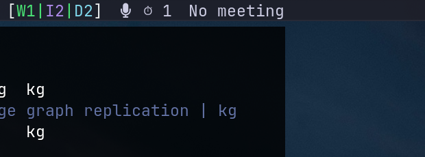

# waybar-herdr

A Waybar module that shows the status of your [Herdr](https://herdr.dev) agent sessions.



Herdr tracks AI coding agents (Claude, Pi, Codex, Copilot, etc.) running in terminal panes. This module polls `herdr agent list` and displays a compact summary in Waybar: which agents are working, blocked, idle, or done.

## What it shows

The bar text shows an icon per state with a count, only for states that have agents in them:

```
󰚩 󰑮3 󰏤1 󰒲2
```

| State | Icon | Color |
|-------|------|-------|
| working | 󰑮 | green |
| blocked | 󰏤 | orange |
| idle | 󰒲 | purple |
| done | 󰄬 | cyan |
| unknown | ? | grey |

Hovering shows a tooltip listing each agent with its type, status, project directory, and terminal title.

The module disappears from the bar when Herdr isn't running or has no agents.

## Install

Copy `herdr.py` somewhere on your machine:

```sh
cp herdr.py ~/.local/share/waybar-herdr/herdr.py
chmod +x ~/.local/share/waybar-herdr/herdr.py
```

Add the module to your Waybar config (or a shared `modules.jsonc`):

```jsonc
"custom/herdr": {
  "format": "{}",
  "return-type": "json",
  "interval": 5,
  "exec": "~/.local/share/waybar-herdr/herdr.py",
  "exec-if": "herdr status --json 2>/dev/null | jq -e '.server.running == true' >/dev/null 2>&1",
  "on-click": "~/.local/share/waybar-herdr/herdr.py focus",
  "on-click-right": "~/.local/share/waybar-herdr/herdr.py menu",
},
```

Add `"custom/herdr"` to whichever bar section you want (e.g. `modules-left`).

Add to your `style.css`:

```css
#custom-herdr {
  padding: 0 2px;
}
#custom-herdr.working { color: @green; }
#custom-herdr.blocked { color: @orange; }
#custom-herdr.idle { color: @purple; }
#custom-herdr.done { color: @cyan; }
#custom-herdr.unknown { color: @comment; }
```

Adjust the colors to match your theme.

Reload Waybar:

```sh
killall -SIGUSR2 waybar
```

## Click actions

Left-click focuses the most urgent agent. Blocked agents get priority (they need your attention), then working, then idle. The script calls `wm-jumpapp` to raise the terminal window and `herdr agent focus` to switch to the agent's pane.

Right-click opens a fuzzel menu listing all agents. Pick one to focus it.

## Configuration

Set `HERDR_TERMINAL` to change which terminal app gets focused (defaults to `kitty`). You can set this in the waybar module config:

```jsonc
"custom/herdr": {
  "env": { "HERDR_TERMINAL": "ghostty" },
  ...
},
```

The script uses [wm-jumpapp](https://github.com/chmouel/chmouzies) to focus windows, which works with Sway, Hyprland, and Niri.

## Requirements

- [Herdr](https://herdr.dev) with at least one agent integration installed (`herdr integration status`)
- Python 3
- `jq` (for `exec-if`)
- [wm-jumpapp](https://github.com/chmouel/chmouzies) (for click-to-focus)
- [fuzzel](https://codeberg.org/dnkl/fuzzel) (for the right-click menu)
- A Nerd Font in your Waybar config

## License

MIT
